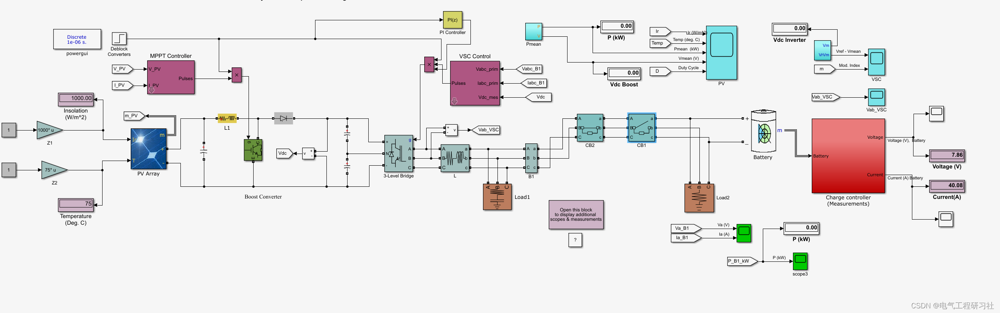
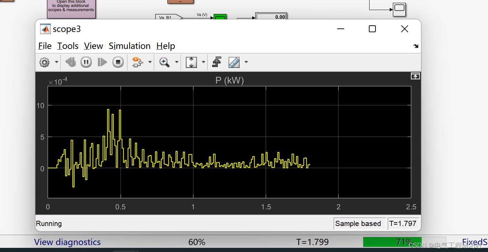
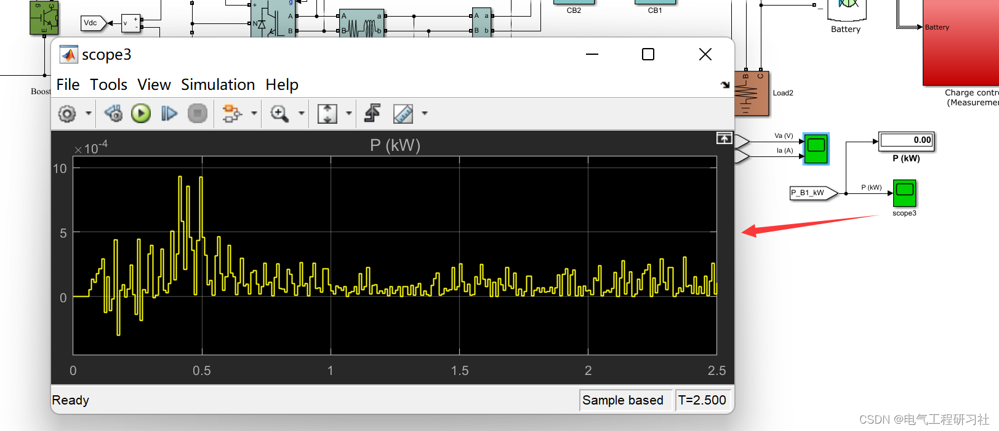
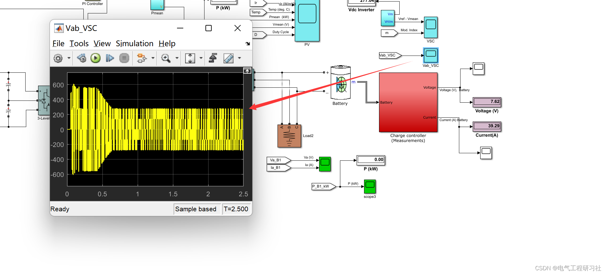
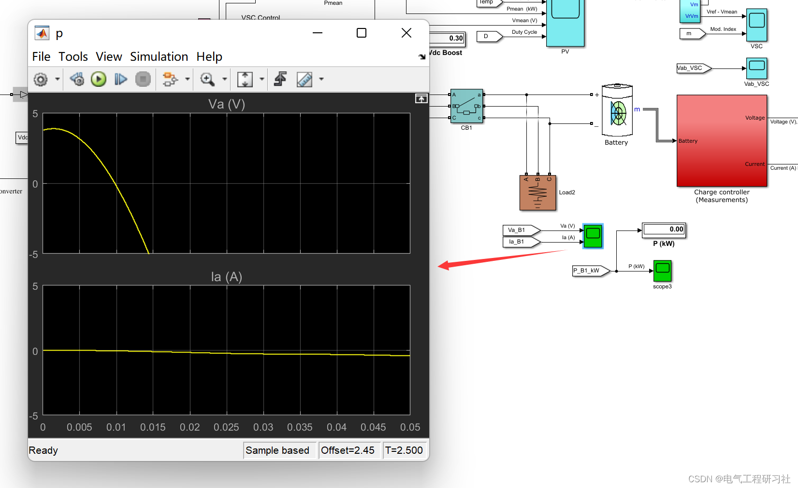
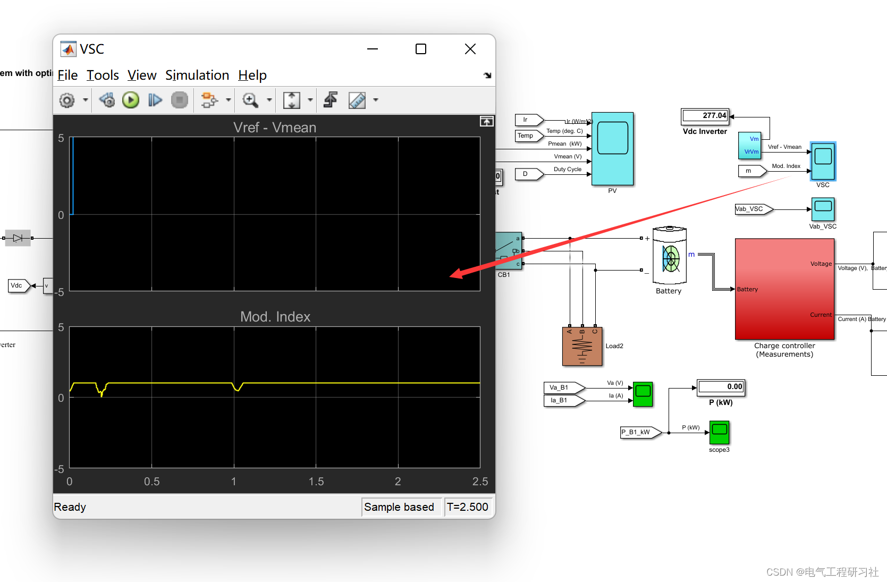
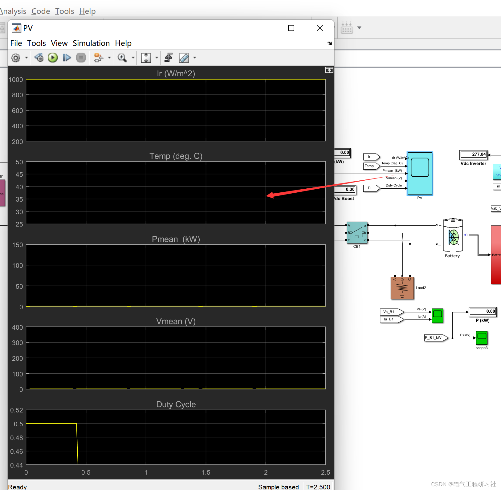

# Photovoltaic System Control Based on Multiple Optimization Algorithms and Neural Networks (Matlab Code Implementation)

​  
📋📋📋This article is organized as follows: ⛳️⛳️⛳️1 Overview In this paper, we designed a Simulink model based on the photovoltaic system architecture, which consists of photovoltaics, batteries, converters, PI controllers, inverters, and charging control. Next, we deploy the MPPT controller. Then we apply the optimization algorithm in the MPPT controller. The optimization algorithms used are Genetic Algorithm (GA), Particle Swarm Optimization (PSO) and Neural Network (NN). The optimal value is based on sunlight and temperature. Then, we calculate the maximum power and voltage from the optimization algorithm. Next, we implement the inverter, which converts the power generated by the system from direct current to alternating current. The charging controller can prevent overcharging of the connected battery. Finally, the system is evaluated by voltage, current and power graphs of the following scenarios.
2. Model Setup Edit
3. Running waveforms - Editing
Editor
Editor
Editor
Editor
4 Model Acquisition - If you're lazy and don't want to build it yourself, click here for a download: Photovoltaic System Control Based on Multiple Optimization Algorithms and Neural Networks (Matlab Code Implementation)
5. End Note: The references to theoretical concepts are from online literature sources, and if any infringement is found, please contact the blogger for removal.
​  

## Images

<!-- PAYMENT_BLOCK -->

## Get this dataset

- Payment link (Stripe): [Buy now](https://buy.stripe.com/3cs8yP7sY87d0vu9AB)
- Payment QR code: 

<!-- /PAYMENT_BLOCK -->
